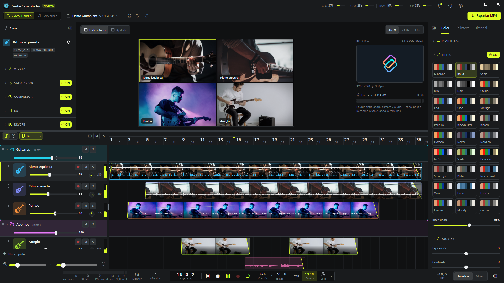

# GuitarCam Studio Native

**GuitarCam Studio Native** es una aplicación de escritorio para Windows para hacer **videos de guitarra**:
grabás tomas con cámara y audio, las mezclás y exportás un video con un panel por toma.

Funciona tanto como un **cam studio** (grabar tomas con cámara y armar el video) como un **DAW** (grabar,
editar y mezclar audio en un timeline y un mixer completos, con o sin imagen: el modo **Solo audio**
sirve para hacer música sin video).

Está pensada para usarse con la guitarra colgada: atajos de una tecla, botones grandes y un camino corto
de **grabar → mezclar → exportar**.




## Qué hace

- **Graba** audio por ASIO (entrada y salida en un mismo callback, con monitoreo) y video desde una cámara
  (DirectShow o DroidCam por IP). Cada toma se escribe a disco mientras ocurre, así que un corte no la pierde.
- **Edita en un timeline**: varias pistas, clips que se mueven, recortan, dividen y duplican, fades, rango
  de borrado, deshacer y rehacer ilimitados, e importación de audio de afuera (WAV, MP3, FLAC, OGG, M4A, AIFF).
- **Mezcla** con una cadena de efectos por pista: saturación ("Vida", válvula o cinta), compresor con
  presets (Rasgueo / Arpegio / Punteo), EQ de 6 bandas con espectro en vivo, y envíos a reverb y delay,
  más limitador master, paneo con plantillas y un mixer completo.
- **Compone el video**: un panel por pista con cover-fit, zoom, paneo y espejo, relaciones 16:9 / 9:16 / 1:1,
  disposición lado a lado o apilada, y una pestaña de color (filtros, ajustes, efectos y plantillas).
- **Exporta** a MP4 (mezcla offline + FFmpeg, con progreso y cancelación) o, en el modo **Solo audio**, a
  WAV de 24 bits o MP3 de 320 kbps. Lo que ves en la vista previa es lo que se exporta.
- **Metrónomo** con compás, tempo, tap tempo, cuenta previa y seis sonidos de click; calibración de latencia
  con cable o tocando.
- **No pierde nada**: autoguardado atómico 1,5 s después de cada edición, copias en `historial/` para volver
  atrás, recuperación de grabaciones interrumpidas y un gestor de proyectos con Papelera.
- Idiomas, tema y atajos de teclado configurables.

## Hacia dónde va

GuitarCam Studio Native está **en desarrollo constante**. La idea es llevarla a un nivel que sirva tanto
para quien recién empieza y quiere hacer música rápido y sin complicaciones, como para profesionales que
quieren hacer música en serio.

Lo próximo es la compatibilidad con **MIDI**, **plugins VST** y más herramientas de estudio. Lo que está
planeado y lo que falta está en [PENDIENTES.md](PENDIENTES.md).

## Requisitos

- Windows 10/11 de 64 bits.
- Una interfaz de audio con driver **ASIO**.
- **FFmpeg** y **ffprobe** en el `PATH` (cámara, video y exportación).
- [.NET 10 SDK](https://dotnet.microsoft.com/) para compilar.

## Compilar y ejecutar

```
dotnet build
src\GuitarCam.App\bin\Debug\net10.0-windows\GuitarCam.exe
```

La app arranca en el gestor de **Proyectos** (lista, buscador, plantillas, renombrar, duplicar, Papelera).
Con una carpeta de proyecto como argumento, la abre directo. `tools\make-shortcut.ps1` crea un acceso
directo en el escritorio. Los ajustes se guardan en `%APPDATA%\GuitarCam Studio`.

## Atajos principales

Todos se pueden cambiar en ⚙ Configuración → Atajos de teclado (menos Esc).

| Tecla | Acción |
|---|---|
| Espacio | reproducir / parar |
| Shift+R o Num * | grabar (grabando: detener y guardar) |
| R | armar / desarmar la pista seleccionada |
| Inicio | volver al principio |
| C / Shift+C / T | click / cuenta previa / tap tempo |
| M / S | mute / solo de la pista |
| F | ver todo |
| X | timeline / mixer |
| Alt+X / D | dividir el clip en el cabezal / duplicarlo |
| Supr | quitar el clip (o la pista vacía) |
| Ctrl+Z / Ctrl+Y | deshacer / rehacer |
| Ctrl+Shift+N | nueva pista |
| Ctrl+S | guardar ya |
| B / P | mostrar u ocultar el panel de la toma / del proyecto |
| Rueda, Shift+rueda, Alt+rueda | desplazar, zoom, alto de pista |

## Cómo está hecho

```
src/
  GuitarCam.Audio      motor de audio: DSP, ASIO dúplex, click, grabación a disco, exportación
  GuitarCam.Projects   modelo del proyecto, guardado atómico, historial, gestor de proyectos
  GuitarCam.App        la ventana (Avalonia 11.3)
  GuitarCam.Lab        gclab.exe: consola para probar audio, DSP y proyectos sin la ventana
tools/                 ícono, acceso directo y utilidades de verificación
```

Las dependencias van hacia abajo (App → Projects → Audio): el motor y el modelo del proyecto no conocen la
interfaz, y todo lo que hacen se puede ejercitar desde `gclab`. El proyecto se guarda en una carpeta:

```
guitarcam.json        el proyecto
guitarcam.json.bak    el guardado anterior
historial/            copias para volver atrás
media/                grabaciones e importados (nunca se reescriben)
exports/              videos y audios exportados
```

Si vas a colaborar o a usar un agente de IA, leé primero [AGENTS.md](AGENTS.md). Lo que falta hacer está en
[PENDIENTES.md](PENDIENTES.md).

## gclab

`gclab.exe` (`src\GuitarCam.Lab\bin\Debug\net10.0-windows\gclab.exe`) prueba el motor y los proyectos desde
la consola, sin abrir la ventana.

| Comando | Qué hace |
|---|---|
| `dispositivos` / `panel` | drivers ASIO y dispositivos WASAPI / panel del driver (tamaño de buffer) |
| `latencia [--modo cable\|tocando] [--ver] [--borrar]` | mide la latencia ida y vuelta, o muestra / borra la guardada |
| `grabar --monitor --sat valvula` | graba sobre el click; con `--monitor` te escuchás con el efecto (también `--ganancia`, `--descartar`, `--entradas 1,2,3-4`) |
| `mezclar proyecto\|toma.wav [--salida mezcla.wav]` | renderiza la mezcla offline, con el mismo grafo que la reproducción |
| `procesar toma.wav --sat cinta --comp-estilo punteo --eq ritmica --reverb cuarto --delay punteada` | aplica efectos a un WAV |
| `click` | escribe todos los sonidos de click a un WAV |
| `sistema [--segundos 5]` | CPU, GPU y RAM, y si FFmpeg está en el PATH |
| `espectro [toma.wav]` | el espectro en vivo del EQ |
| `camara [listar]` | las cámaras que ve FFmpeg y sus formatos |
| `camara grabar [--dispositivo X \| --ip 192.168.1.50:4747] [--segundos 5]` | graba video como una toma y lo revisa con ffprobe |
| `camara verificar-corte` | corta una grabación a la mitad y comprueba que el video quede |
| `exportar [proyecto] [--calidad alta\|estandar\|borrador] [--salida nombre]` | exporta el MP4 |
| `exportar proyecto --audio wav\|mp3` | exporta solo la mezcla |
| `proyecto abrir\|clips\|versiones\|volver carpeta` | abre un proyecto, lista pistas y clips, y recorre el historial |
| `proyecto toma\|cortar carpeta [--camara]` | graba un tono como la ventana / lo corta sin cerrar, para probar la recuperación |
| `proyecto editar carpeta mover\|recortar-inicio\|recortar-final\|fade-in\|fade-out clip delta` | edita un clip como en el timeline (más: `a-pista`, `dividir`, `duplicar`, `quitar-clip`, `nueva-pista`…) |
| `proyecto encuadre\|sincronia\|formato\|modo carpeta …` | encuadre del clip, ajuste de sincronía, formato del video y modo Video / Solo audio |
| `proyecto importar-audio carpeta archivo` | copia un audio de afuera a `media/` y lo pone en una pista |
| `proyecto historial carpeta` | tomas en uso y no usadas, exportaciones y actividad |
| `proyecto verificar-deshacer\|verificar-clips\|verificar-tomas\|verificar-importar\|verificar-historial` | pruebas automáticas sobre una carpeta temporal |
| `proyectos lista\|plantillas\|nuevo\|renombrar\|duplicar\|borrar\|olvidar\|carpeta` | lo que hace el gestor de proyectos |
| `proyectos guardar-plantilla\|borrar-plantilla` | plantillas de proyecto del usuario |
| `proyectos plantillas-video\|guardar-plantilla-video\|aplicar-plantilla-video\|borrar-plantilla-video` | plantillas de video (filtro, ajustes y efectos) |

En `proyecto` y `proyectos`, `--datos X` usa otra carpeta para la configuración, los recientes y las
plantillas (para probar sin tocar los tuyos), y `--raiz X` otra carpeta de proyectos.
