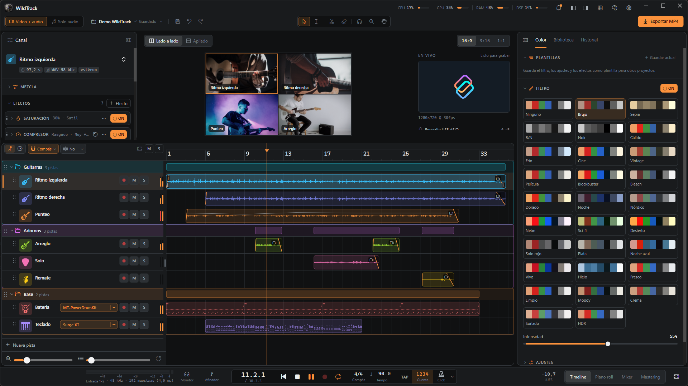
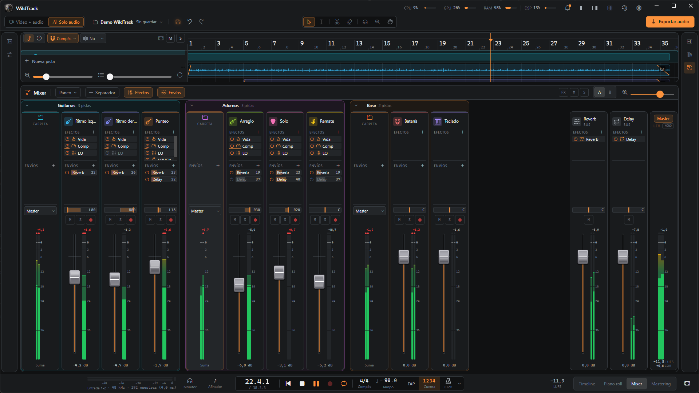
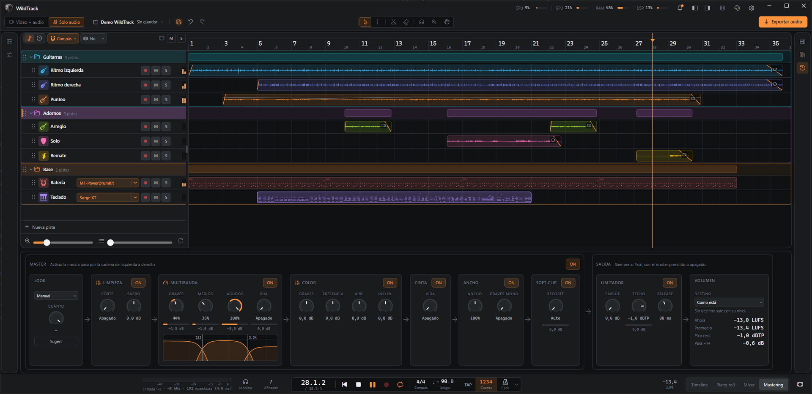
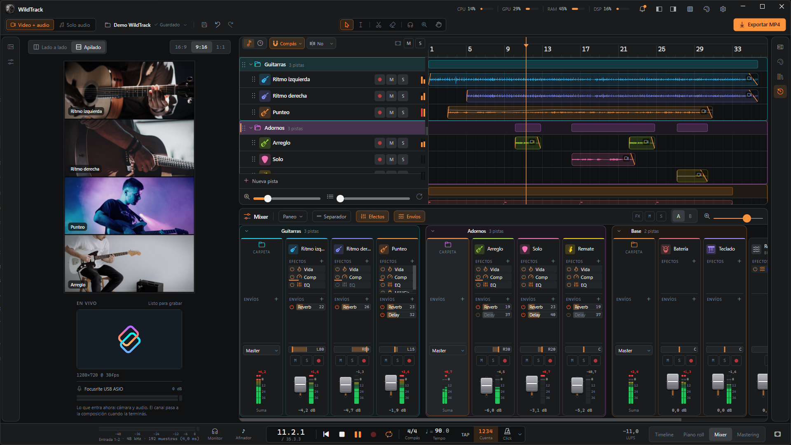
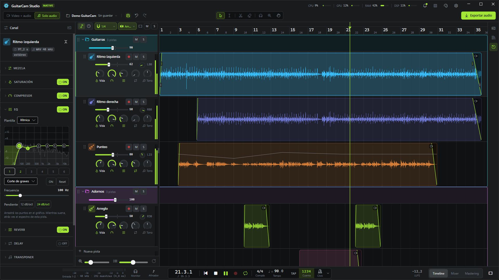

# WildTrack

**Español** · [English](README_EN.md)

**WildTrack** es un DAW de escritorio para Windows que también hace **videos de guitarra**:
grabás tomas con cámara y audio, las mezclás y exportás un video con un panel por toma.
Antes se llamaba **GuitarCam Studio Native**: al actualizar, tus ajustes y proyectos siguen ahí.

Funciona tanto como un **cam studio** (grabar tomas con cámara y armar el video) como un **DAW** (grabar,
editar y mezclar audio en un timeline y un mixer completos, con o sin imagen: el modo **Solo audio**
sirve para hacer música sin video).

Está pensada para usarse con la guitarra colgada: atajos de una tecla, botones grandes y un camino corto
de **grabar → mezclar → exportar**.

<p align="center">
  <a href="https://github.com/xtrimdr/WildTrack/releases/latest/download/WildTrack-Setup.exe">
    
  </a>
  <br>
  <sub>Windows 10/11 de 64 bits · instalador autocontenido, sin instalar .NET</sub>
</p>

<details>
<summary><b>Antes de instalar</b></summary>

- **FFmpeg** y **ffprobe** en el `PATH`, para la cámara, el video y la exportación. Si no están, WildTrack te avisa
  al abrir y lo instala con un clic (winget), o te lleva a la página para bajarlo.
- Una interfaz de audio con driver **ASIO**, para grabar.
- El instalador no está firmado: si Windows SmartScreen avisa, elegí **Más información → Ejecutar de todas formas**.

Más detalles en [Requisitos](#requisitos).
</details>



| | |
|---|---|
|  |  |
| **El mixer**: una tira por pista, las carpetas, los buses de reverb y delay y el master. | **Mastering**: Look, limpieza, multibanda, color, Cinta, Ancho, soft clip y limitador, con el Destino de volumen y "Sugerime". |
|  |  |
| **Vertical 9:16** con el diseño Vertical: el video a lo alto y el timeline y el mixer al lado. | **Solo audio**: pistas con sus knobs de efecto y el EQ con el espectro en vivo. |

*Las capturas son del proyecto de demo; las imágenes de los paneles son fotos de [Unsplash](https://unsplash.com).*

## Qué hace

### Grabar

- Audio por **ASIO** (entrada y salida en un mismo callback, con monitoreo) y video desde una cámara (DirectShow o
  DroidCam por IP). Cada toma se escribe a disco mientras ocurre, así que un corte no la pierde.
- Se graba desde donde esté el cabezal, para regrabar solo un pedazo, con **metrónomo** (compás, tempo, tap tempo,
  cuenta previa y seis sonidos de click) y **calibración de latencia** con cable o tocando.
- **Afinador** con notas en castellano, flechas que te dicen para dónde girar la clavija y sensibilidad ajustable.

### Editar

- **Timeline** con varias pistas: clips que se mueven, recortan, dividen y duplican, fades, ganancia por clip con su
  **curva de volumen**, rango de borrado, deshacer y rehacer ilimitados, e importación de audio de afuera (WAV, MP3,
  FLAC, OGG, M4A, AIFF). **Detectar tempo** en cualquier clip (clic derecho) y poner el proyecto a esos BPM.
  **Extraer MIDI**: las notas de un clip de audio (acordes o melodía) pasan a una pista MIDI, con el clic derecho o
  arrastrando el clip a una pista MIDI (Basic Pitch de Spotify, en la CPU).
- **Carpetas** que se pliegan y agrupan pistas; varias pistas se marcan con Ctrl+clic / Shift+clic y se mueven juntas.
  Cada pista tiene su **color** (24, en orden de arco iris) y un **ícono de instrumento** (guitarras, bajo, batería,
  synths, cuerdas, vientos, percusión…), su propio alto y sus knobs de Vida, Comp, Reverb, Delay y Tono en el
  encabezado (cuáles se ven, en Configuración → Vista).
- Un sonido que te gusta se guarda como **plantilla de pista** y vuelve desde Nueva pista → Plantilla.
- **Pistas MIDI** para armar la base: doble clic en su carril crea un clip y lo abre en el **piano roll** (el botón
  "Piano roll" del transporte). Clic escribe una nota, arrastrar la mueve o la alarga, clic derecho borra, y abajo va la
  velocidad de cada nota. Cada pista MIDI toca con un **instrumento VST3** (Surge XT, MT-PowerDrumKit…: clic derecho
  en la pista → Instrumento, o el botón del piano roll, que también abre la ventana del plugin) o, sin plugin, con un
  tono de prueba. Cada plugin corre en su propio proceso: si se cuelga, se calla ese y el resto sigue sonando.
- Arriba de la regla, un **rango A–B** para repetir un tramo (practicar el solo, mezclar un pedazo) y **marcadores**
  con nombre (Intro, Estribillo, Solo…) para saltar de una parte a otra. Zoom de un tiempo a toda la canción con
  atajos que se asignan en Configuración → Atajos de teclado.
- **Marcas de duración por red** (clic derecho en la regla; con clic derecho en una opción el menú queda abierto): una
  línea donde termina una historia, un post de X, un Reel o Short, un TikTok, así sabés mientras grabás si el tema entra. Si te pasás, la línea se pone ámbar; la de
  historias se repite en cada corte.

### Mezclar

- Cadena de efectos por pista: saturación (**Vida**, válvula o cinta), **compresor** con presets (Rasgueo / Arpegio /
  Punteo), **EQ de 6 bandas** con espectro en vivo, **puerta de ruido** para el zumbido entre frases, y envíos a
  **reverb** y **delay**, más limitador master, botón **MONO** para chequear la mezcla y paneo con plantillas.
- **Transponer** por pista (−12 a +12 semitonos) sin cambiar el largo, así la toma sigue en sincronía con el video:
  se calcula en segundo plano (unos 4 s por 3 min) con un vocoder de fase de alta calidad, se ve el progreso sobre los
  clips y queda guardada en `cache/`.
- **Mixer** completo con **buses**: cada pista o carpeta elige su salida (el master o un bus) y manda a los buses
  con sus envíos (antes o después del fader); los buses salen al master. Un bus tiene volumen, paneo y efectos, así que sirve para una reverb, un
  delay o para procesar un grupo (un compresor para todas las guitarras). Las carpetas solo agrupan. Las tiras se
  ordenan arrastrándolas en el mixer (el timeline las sigue), van a la izquierda o a la derecha, y hay separadores con
  nombre para ordenar proyectos grandes.
- **A | B** en la barra del mixer: dos mezclas de las mismas tomas (canales, envíos y buses) para ir y venir mientras
  suena; la B arranca como copia de la A y el clic derecho copia una sobre la otra u olvida la otra.
- Audio de nivel profesional: arrancar, parar, saltar y arrastrar el cabezal llevan su fundido, sin clics ni cortes.

### Armar el video

- Un panel por pista con cover-fit, zoom, paneo y espejo; relaciones **16:9 / 9:16 / 1:1**, disposición lado a lado
  o apilada.
- Pestaña de **color** con 28 looks (Brujo, Cine, Moody, Fresco, Noche azul, Hielo, Soñado, HDR…), ajustes (exposición, contraste,
  Blancos, Negros, Sensación de luz…), efectos (Nitidez, Claridad, Resplandor, viñeta, grano, barras de cine) y plantillas. Lo que ves en la vista previa es lo que se exporta.

### Exportar

- **MP4** (mezcla offline + FFmpeg, con progreso y cancelación), con presets para **Reels · TikTok**, **YouTube** e
  **Instagram** (1:1 y 4:5) que acomodan el cuadro. El volumen sale del **Destino** del master (YouTube, Instagram,
  TikTok, Spotify, Apple Music), que se escucha mientras mezclás y la exportación respeta.
- Fácil o a medida: elegís destino y calidad, y si querés, en **Avanzado** la resolución (720p a 4K) y el bitrate.
- El video se codifica con la **placa de video** (NVIDIA, AMD o Intel) si hay una, las tomas se procesan en paralelo
  y la mezcla usa todos los núcleos; si la placa falla, sigue sola con el procesador.
- **Solo el loop A–B** ("Tramo" en el diálogo) para sacar un clip corto del tema, con la reverb y el delay sonando
  hasta apagarse después de B.
- En el modo **Solo audio**, WAV de 24 bits o MP3 de 320 kbps; si querés, además cada pista en su WAV (stems).
  Medidor de **LUFS** del master en la barra de transporte.
### Y además

- **No pierde nada**: guardado atómico (solo después de cada edición, cada X minutos o a mano con Ctrl+S o el
  diskette, a elección en Configuración → Guardado y exportación; las tomas se guardan siempre), copias en `historial/` para volver
  atrás, recuperación de grabaciones interrumpidas y un gestor de proyectos con Papelera y **paquetes ZIP** para
  mandar un proyecto a otra compu o guardar un respaldo completo.
- Idiomas, tema, atajos de teclado y diseño de la ventana (Clásico o Vertical, para videos 9:16) configurables.

## Hacia dónde va

WildTrack está **en desarrollo constante**. La idea es llevarla a un nivel que sirva tanto
para quien recién empieza y quiere hacer música rápido y sin complicaciones, como para profesionales que
quieren hacer música en serio.

Ya están las pistas MIDI con su piano roll y los instrumentos VST3; lo próximo son los **efectos VST3** en los slots
de las pistas y los buses, un sampler propio y más herramientas de estudio. Lo que está
planeado y lo que falta está en [PENDIENTES.md](PENDIENTES.md).

## Requisitos

- Windows 10/11 de 64 bits.
- Una interfaz de audio con driver **ASIO**.
- **FFmpeg** y **ffprobe** en el `PATH` (cámara, video y exportación).
- Para la preview, los DLL de **FFmpeg 9** (versión *shared*) en `lib\ffmpeg\` (`avcodec-63`, `avformat-63`,
  `avutil-61`, `swscale-10`, `swresample-7` y su `LICENSE`). No van en git: los baja `tools\get-ffmpeg.ps1` de
  [BtbN/FFmpeg-Builds](https://github.com/BtbN/FFmpeg-Builds/releases) (`ffmpeg-n9.0-latest-win64-lgpl-shared-9.0.zip`,
  carpeta `bin`). El build los copia a `ffmpeg\` junto al exe. Sin ellos la preview usa ffmpeg.exe, que tarda más
  en cada salto.
- [.NET 10 SDK](https://dotnet.microsoft.com/) para compilar.
- Para los plugins VST3 (opcional): Visual Studio con **Desarrollo para el escritorio con C++** y el **Windows 11 SDK**,
  y el SDK de VST3 de Steinberg (licencia MIT) en `lib\vst3sdk`, que baja `tools\get-vst3sdk.ps1` (unos 21 MB, fuera de
  git). Con eso, `dotnet build` también compila `wtvsthost.exe` (`src\WildTrack.VstHost`, C++) y lo copia junto al exe;
  sin eso la app compila igual y las pistas MIDI suenan con el tono de prueba.
- Para **Extraer MIDI**: el modelo de Basic Pitch (Spotify, Apache 2.0, ~230 KB) en `lib\basic-pitch`, que baja
  `tools\get-basic-pitch.ps1` (fuera de git). El build lo copia a `basic-pitch\` junto al exe; sin él, "Extraer MIDI"
  queda deshabilitado y lo dice. Corre con ONNX Runtime (NuGet).

## Compilar y ejecutar

```
tools\probar.ps1 "qué probar"
```

Compila, corre `wtlab comprobar-dsp`, copia la app a `pruebas\<fecha>-<commit>` (fuera de git; quedan las
últimas 5) y la abre desde ahí, con la marca "PRUEBA <commit>" en la barra de título. Como nunca corre desde `bin\`,
la app abierta no traba la próxima compilación. `-Abrir` abre la última copia sin compilar, `-NoAbrir` solo compila y
copia, `-SinComprobar` salta `wtlab`, `-Proyecto carpeta` abre ese proyecto. Si ya hay un WildTrack abierto, antes de abrir
pregunta en un cuadro si lo cierra (guarda el proyecto antes), así la copia nueva no abre el mismo proyecto en solo
lectura. Si algo falla, dice "NO SE PUEDE PROBAR" y no abre nada (desde el acceso directo, que no muestra la consola, queda
anotado en `%APPDATA%\WildTrack\sesiones.log`, junto con cada inicio y cierre de la app y sus errores). `dotnet build` solo sigue sirviendo para compilar.

La app arranca en el gestor de **Proyectos** (lista, buscador, plantillas, renombrar, duplicar, Papelera).
Con una carpeta de proyecto como argumento, la abre directo. Con `--probar "texto"` muestra ese texto en un aviso fijo ("Para probar") al abrir. `tools\make-shortcut.ps1` crea un acceso
directo en el escritorio que abre la última copia de prueba (`probar.ps1 -Abrir`). Los ajustes se guardan en `%APPDATA%\WildTrack`.

## Atajos principales

Todos se pueden cambiar en ⚙ Configuración → Atajos de teclado (menos Esc).

| Tecla | Acción |
|---|---|
| Espacio | reproducir / parar |
| Shift+R o Num * | grabar (grabando: detener y guardar) |
| R | armar / desarmar la pista seleccionada |
| Inicio | volver al principio |
| L | repetir en loop (el rango A–B, o todo el tema) |
| I / O | inicio (A) / final (B) del rango en el cabezal |
| K / , / . | marcador en el cabezal / ir al anterior / al siguiente |
| C / Shift+C / T | click / cuenta previa / tap tempo |
| A | afinador |
| M / S | mute / solo de la pista |
| F | ver todo |
| X | timeline / mixer |
| Alt+X / D | dividir el clip en el cabezal / duplicarlo (o los marcados, en bloque) |
| Q | cuantizar al imán del piano roll: las notas elegidas (o todas) en el piano roll, o los clips MIDI elegidos |
| Ctrl+C / Ctrl+X / Ctrl+V | copiar / cortar los clips elegidos (tomas y clips MIDI) / pegarlos en el cabezal, desde la pista elegida |
| Supr | quitar el clip (o los marcados, o la pista vacía); con un rango, borrarlo |
| Shift+Supr | borrar el rango y cerrar el hueco (lo de después se corre) |
| 1 a 7 | herramientas: Seleccionar / Rango / Dividir / Borrar / Escuchar / Zoom / Mano |
| Ctrl+Z / Ctrl+Y | deshacer / rehacer |
| Ctrl+Shift+N | nueva pista |
| Clic derecho en la regla | cómo se dibuja la grilla: Auto, igual que el imán o una subdivisión fija |
| Arrastrar en vacío sobre las pistas (Ctrl: sumar) | marcar varios clips con un rectángulo para moverlos o borrarlos juntos |
| Ctrl+clic / Shift+clic en un encabezado | marcar varias pistas (una por una / un rango) para moverlas juntas |
| Ctrl+S | guardar ya |
| B / P | mostrar u ocultar el panel de la toma / del proyecto |
| Rueda, Shift+rueda, Ctrl+rueda, Alt+rueda | subir y bajar, zoom, desplazar a los costados, alto de pista (los modificadores y el sentido de cada uno, con "Invertir", se cambian en Configuración → Atajos de teclado; zoom y alto también con los sliders al pie de los encabezados) |

En el clip seleccionado, un clic sobre su línea de volumen agrega un punto; los puntos se arrastran y un
doble clic los saca.

En la franja de arriba de la regla, arrastrar marca el rango A–B (y prende el loop); sus bordes y el rango entero se
arrastran. Doble clic agrega un marcador; los marcadores se arrastran, un clic salta ahí y doble clic los renombra.
Clic derecho en la franja: agregar marcador, empezar o terminar el rango ahí, sacarlo, y en un marcador ponerle un
nombre de la lista o repetir hasta el siguiente. Un rango marcado con Shift+arrastrar (o con la herramienta Rango),
en una pista o en varias, también se puede repetir desde su menú.

Las herramientas del timeline están en el centro de la barra del proyecto: **Seleccionar** (lo de siempre), **Rango**
(marca un tramo de una o varias pistas; clic derecho: borrarlo, borrarlo y cerrar el hueco, repetirlo), **Dividir**
(un clic corta el clip ahí, en la grilla), **Borrar** (saca los clips que toca), **Escuchar** (mantené apretado sobre
un clip para oír esa pista sola desde ahí), **Zoom** (clic acerca, Alt+clic aleja, arrastrar muestra ese tramo) y
**Mano** (arrastrar mueve la vista). Donde dos clips de una pista se pisan, el clic derecho → **Traer al frente**
elige cuál se ve. **Bloquear clip** o **Bloquear pista** (clic derecho) deja una toma que ya quedó bien fija: no se
mueve, no se recorta, no se borra y grabar no la pisa; el volumen, los fades y el encuadre se siguen tocando.

Cada pista o carpeta puede tener su propio alto: arrastrá el borde de abajo de su encabezado (doble clic en el borde
la vuelve al alto general). El botón ↺ al pie de los encabezados iguala todas.

## Cómo está hecho

```
src/
  WildTrack.Audio      motor de audio: DSP, ASIO dúplex, click, grabación a disco, exportación
  WildTrack.Projects   modelo del proyecto, guardado atómico, historial, gestor de proyectos
  WildTrack.App        la ventana (Avalonia 11.3)
  WildTrack.Lab        wtlab.exe: consola para probar audio, DSP y proyectos sin la ventana
  WildTrack.VstHost    wtvsthost.exe (C++): abre un plugin VST3 en su propio proceso
tools/                 ícono, acceso directo y utilidades de verificación
```

Las dependencias van hacia abajo (App → Projects → Audio): el motor y el modelo del proyecto no conocen la
interfaz, y todo lo que hacen se puede ejercitar desde `wtlab`. El proyecto se guarda en una carpeta:

```
guitarcam.json        el proyecto
guitarcam.json.bak    el guardado anterior
historial/            copias para volver atrás
media/                grabaciones e importados (nunca se reescriben)
cache/                tomas transpuestas (se rehacen solas si se borran)
exports/              videos y audios exportados
```

## Contribuir y licencia

WildTrack es **gratis y sin fines de lucro**: se hace para la comunidad, para que cualquiera
pueda grabar y hacer música sin pagar un peso. Las contribuciones son bienvenidas y **todas pasan por la
aprobación del mantenedor**: abrí un issue o un Pull Request siguiendo [CONTRIBUTING.md](CONTRIBUTING.md).
Antes de tocar código, leé [AGENTS.md](AGENTS.md) (la guía del proyecto) y mirá [PENDIENTES.md](PENDIENTES.md)
para ver qué falta.

Se distribuye bajo la licencia [GPL-3.0](LICENSE): podés usarla, estudiarla, modificarla y compartirla
libremente, y las versiones modificadas que se distribuyan tienen que seguir siendo libres bajo la misma licencia.

## Firma del código

El instalador se arma en GitHub Actions a partir de este repositorio ([instalador.yml](.github/workflows/instalador.yml)),
nunca en la PC de nadie, así lo que bajás sale de este código. Firma gratuita de código por
[SignPath.io](https://about.signpath.io), certificado de [SignPath Foundation](https://signpath.org).

- Commits y revisión: [xtrimdr](https://github.com/xtrimdr) (todo cambio de otra persona pasa por su aprobación).
- Aprobación de cada firma: [xtrimdr](https://github.com/xtrimdr).

**Privacidad**: el programa no manda información a ningún otro sistema, salvo lo que pidas vos: busca si hay una
versión nueva consultando la última release en GitHub (se apaga en Acerca de) y se conecta a la cámara por red que
configures.

## wtlab

`wtlab.exe` (`src\WildTrack.Lab\bin\Debug\net10.0-windows\wtlab.exe`) prueba el motor y los proyectos desde
la consola, sin abrir la ventana.

| Comando | Qué hace |
|---|---|
| `dispositivos` / `panel` | drivers ASIO y dispositivos WASAPI / panel del driver (tamaño de buffer) |
| `latencia [--modo cable\|tocando] [--ver] [--borrar]` | mide la latencia ida y vuelta, o muestra / borra la guardada |
| `grabar --monitor --sat valvula` | graba sobre el click; con `--monitor` te escuchás con el efecto (también `--ganancia`, `--descartar`, `--entradas 1,2,3-4`) |
| `mezclar proyecto\|toma.wav [--salida mezcla.wav] [--cadena vida,comp,eq,puerta]` | renderiza la mezcla offline, con el mismo grafo que la reproducción; con un WAV, `--cadena` arma los slots en ese orden (se pueden repetir) |
| `procesar toma.wav --sat cinta --comp-estilo punteo --eq ritmica --reverb cuarto --delay punteada` | aplica efectos a un WAV |
| `click` | escribe todos los sonidos de click a un WAV |
| `sistema [--segundos 5] [--instalar-ffmpeg]` | CPU, GPU y RAM, si FFmpeg está en el PATH y con qué placa de video exporta; `--instalar-ffmpeg` lo instala antes con winget, como el aviso de la ventana |
| `version` | esta versión contra la última release de GitHub (lo que avisa la ventana y muestra "Acerca de") |
| `espectro [toma.wav]` | el espectro en vivo del EQ |
| `comprobar-dsp` | comprobaciones propias del DSP: remuestreo, tomas, reinicio de la cadena, afinador, LUFS y mastering (bandas que suman plano, reducción por banda sin importar el nivel, Cinta, Ancho (graves mono y mismo volumen), soft clip, limitador prendido y apagado) y slots de efectos (un canal viejo migrado suena idéntico a la cadena fija, repetir, reordenar, cambio de lista sin saltos), puerta de ruido (baja el zumbido, deja pasar la nota, no aletea cuando una nota se apaga); además Nitidez, Claridad y Resplandor (un cuadro plano queda igual, un borde se marca, una luz en lo oscuro deja su halo de su color, los looks HDR y Soñado suman lo suyo solo con el filtro prendido) |
| `looks [--look id] [--salida look.cube] [--blancos n] [--negros n] [--luz n]` | los looks de color con colores de prueba, comprobación de rango y, con `--look`, el LUT `.cube` de ese look con Blancos, Negros y Sensación de luz |
| `masterizar archivo.wav [--cuanto 0.35] [--banda-graves\|--banda-medios\|--banda-agudos 0..1] [--corte] [--barro] [--graves] [--presencia] [--aire] [--inclinacion] [--cinta] [--ancho] [--graves-mono] [--recorte] [--empuje] [--techo] [--release] [--sin-limitador] [--volumen youtube\|instagram\|tiktok\|spotify\|apple] [--pua 0..1] [--look natural\|glue\|bright\|warm\|front\|pick [--cuanto-look 1]] [--sugerime]` | el mastering de la ventana sobre un WAV: cuánto comprime cada banda (y la Púa), cuánto recortan el soft clip (Auto incluido) y el limitador y los LUFS de entrada y salida; `--volumen` es el Destino del master (mide el archivo y usa esa ganancia en vez del Empuje), `--look` pone un look, `--sugerime` muestra qué oye y qué propone, y masteriza con eso |
| `midi ver\|pista\|clip\|nota\|acordes\|quitar carpeta` | pistas MIDI, sus clips y sus notas (`clip --pista n --en 0 --compases 4`, `nota --clip id --altura C4 --pulso 0 --largo 1 --vel 100`, `acordes --clip id` escribe Do, Sol, Lam, Fa); `mezclar carpeta` las renderiza |
| `midi cuantizar carpeta --clip id [--grilla 1/16]` | mueve el comienzo de las notas a la grilla de la canción (1/4, 1/8, 1/16, 1/32, 1/8T) |
| `midi velocidad carpeta --clip id [--rango 100]` | escala las velocidades alrededor de su promedio (50 las acerca, 0 las empareja, 150 da más dinámica) |
| `midi humanizar carpeta --clip id [--cantidad 10] [--semilla n]` | mueve cada velocidad al azar hasta ± cantidad |
| `midi entradas` | los teclados y controladores MIDI que ve Windows, con sus ajustes de Configuración → MIDI |
| `midi escuchar [--entrada nombre] [--segundos 10]` | abre las entradas como la ventana e imprime lo que llega y lo que toma el motor (canal y curva de velocidad aplicados) |
| `midi instrumento carpeta [--pista n] --plugin "nombre" \| --quitar` | el instrumento VST3 que toca la pista; `mezclar carpeta` lo renderiza con el plugin, como la exportación |
| `vst escanear [--todo] [--archivo X]` / `vst lista` | busca los plugins VST3 (cada archivo en su propio proceso; los recuerda en `plugins.json`; `--archivo` reintenta uno) / los lista |
| `vst carpetas [--agregar X] [--sacar X]` / `vst ocultar\|mostrar "nombre"` | dónde se buscan los plugins y cuáles salen en los menús (lo mismo que Configuración → Plugins) |
| `vst probar "nombre" [--segundos 4] [--ventana] [--espera s] [--tiempo-real]` | toca un acorde (o un ritmo, si es una batería) con el plugin a un WAV, por el mismo puente que la exportación; `--ventana` abre antes su ventana. Con la variable `GCVST_DEBUG=1`, el puente cuenta sus salidas y cada bloque |
| `midi comprobar` | el sonido de las notas: igual en cualquier tamaño de bloque, termina con el release, la exportación suena como la reproducción y el clip pasa a notas con el tempo; y el teclado: una tecla suena como la nota escrita, el pedal, las tomas, cuantizar y el clip grabado (también corre en `comprobar-dsp`) |
| `transponer archivo.wav [--semitonos 2] [--salida x.wav]` | cambia el tono sin cambiar el largo, como el Transponer de la pista (de −12 a +12, admite cents) |
| `proyecto editar carpeta transponer pista semitonos` | el Transponer de esa pista; deja sus tomas transpuestas en `cache/` |
| `lufs archivo` / `afinar archivo [--en segundos] [--umbral -50]` | volumen integrado de un archivo / la nota que oye el afinador en ese momento, con la sensibilidad de la ventana (dB) |
| `tempo archivo [--desde s] [--hasta s]` | los BPM de un archivo (o de ese tramo), su primer golpe y qué tan seguro está, como "Detectar tempo" en el clic derecho de un clip |
| `extraer-midi archivo [--melodia] [--desde s] [--hasta s] [--inicio 0.5] [--nota 0.3] [--min-ms 70] [--midi x.mid] [--bpm 120] [--verdad notas.json] [--callado]` | las notas de un archivo, como "Extraer MIDI" en un clip; `--midi` las guarda en un .mid y `--verdad` las puntúa contra notas conocidas (`[[inicio s, largo s, nota], …]`); `--comprobar` corre solo sus comprobaciones |
| `nitidez [video\|imagen] [--en 1] [--nitidez 60] [--claridad 60] [--resplandor 0] [--look hdr\|dreamy] [--intensidad 100] [--alto 1080] [--ancho-preview 640] [--carpeta dir]` | compara Nitidez, Claridad y Resplandor (y lo que suman los looks HDR y Soñado) de la exportación (FFmpeg) con los de la preview sobre el mismo cuadro, a tamaño de exportación y al ancho que muestra la preview; mide cuánto cuestan por cuadro y deja PNG para mirarlas |
| `leer-video archivo [--cpu] [--saltos 20] [--cuadro 12.5 --salida x.bmp] [--comparar]` | mide el decodificador de la preview (FFmpeg dentro de la app): abrir, leer seguido, saltar y memoria por cuadro; `--comparar` lo mide contra ffmpeg.exe (tiempo por salto y diferencia de imagen) |
| `camara [listar]` | las cámaras que ve FFmpeg y sus formatos |
| `camara grabar [--dispositivo X \| --ip 192.168.1.50:4747] [--segundos 5]` | graba video como una toma y lo revisa con ffprobe |
| `camara verificar-corte` | corta una grabación a la mitad y comprueba que el video quede |
| `exportar [proyecto] [--calidad alta\|estandar\|borrador] [--salida nombre]` | exporta el MP4 |
| `exportar proyecto --audio wav\|mp3` | exporta solo la mezcla |
| `exportar proyecto … --stems` | además, un WAV por pista en `<nombre> - stems` |
| `exportar proyecto … --rango 12-45\|1:05-1:30\|loop` | solo ese tramo (`loop` = el A–B del proyecto), con la cola de efectos después de B |
| `exportar proyecto … --codificador auto\|cpu\|nvenc\|amf\|qsv` | quién codifica el video (auto = la placa de video si hay) |
| `exportar proyecto … --resolucion 720\|1080\|1440\|2160 --bitrate 20` | el "Avanzado" del diálogo: lado corto del cuadro y bitrate del video en Mbps |
| `exportar proyecto … --destino reels\|youtube\|ig-square\|ig-portrait [--volumen como-esta\|youtube\|…] [--lufs -14] [--cola 8]` | con el cuadro de esa red; el volumen es el Destino del master del proyecto (`--volumen` lo cambia para esta exportación, `--lufs` lleva la mezcla a ese volumen integrado), `--cola` deja sonar reverb y delay hasta N s después del último clip (0 = corta). Muestra los LUFS del resultado |
| `proyecto abrir\|clips\|versiones\|volver carpeta` | abre un proyecto, lista pistas y clips, y recorre el historial |
| `proyecto toma\|cortar carpeta [--camara]` | graba un tono como la ventana / lo corta sin cerrar, para probar la recuperación |
| `proyecto editar carpeta mover\|recortar-inicio\|recortar-final\|fade-in\|fade-out clip delta` | edita un clip como en el timeline (más: `a-pista`, `dividir`, `duplicar` (varios ids con comas), `pegar`, `ganancia`, `curva`, `quitar-clip`, `nueva-pista`…) |
| `proyecto mezcla carpeta [ab\|copiar\|olvidar]` | el A \| B del mixer: pasa a la otra mezcla, copia esta sobre la otra u olvida la otra |
| `proyecto verificar-ab` | comprueba el A/B de la mezcla |
| `proyecto editar carpeta bloquear\|desbloquear clip\|pista` | fija un clip (o toda la pista): no se mueve, no se recorta, no se borra y grabar no lo pisa |
| `proyecto verificar-bloqueo` | comprueba la regla del bloqueo |
| `proyecto editar carpeta transicion clip corte\|fundido\|negro [--segundos 0.5]`, `proyecto transiciones carpeta` | la transición que entra a ese clip (imagen y sonido) y la lista de uniones de cada pista |
| `proyecto editar carpeta nueva-carpeta\|a-carpeta\|sacar-de-carpeta\|mover-carpeta\|quitar-carpeta\|carpeta …` | carpetas de pistas: agrupar, mover adentro y afuera, renombrar y plegar |
| `proyecto editar carpeta nuevo-separador [nombre] [--en n] [--visible] \| lado id izquierda\|derecha` | separadores con nombre (nacen ocultos en el timeline salvo `--visible`; `carpeta id --ocultar` lo alterna) y de qué lado del mixer va cada tira |
| `proyecto editar carpeta guardar-plantilla pista [nombre] \| usar-plantilla nombre \| aplicar-plantilla pista nombre`, `proyecto plantillas-de-pista x` | plantillas de pista (`pistas.json`) |
| `proyecto encuadre\|sincronia\|formato\|modo carpeta …` | encuadre del clip, ajuste de sincronía, formato del video y modo Video / Solo audio |
| `proyecto importar-audio carpeta archivo` | copia un audio de afuera a `media/` y lo pone en una pista |
| `proyecto marcadores carpeta [agregar\|mover\|renombrar\|quitar … \| capitulos]`, `proyecto repetir carpeta [desde hasta \| --quitar]` | marcadores del tema y rango A–B del loop (`capitulos`: los marcadores como capítulos de YouTube) |
| `proyecto duracion carpeta` | cuánto dura el tema y si entra en cada red (historias, X, Reels · Shorts, TikTok) |
| `proyecto historial carpeta` | tomas en uso y no usadas, exportaciones y actividad |
| `proyecto insertos carpeta pista [agregar vida\|comp\|eq\|puerta [--en n] \| quitar n \| mover n m \| duplicar n \| prender n \| apagar n \| plegar n]` | los slots de efectos de la pista en su orden; sin operación, los lista (`plegar` lo pliega en el mixer) |
| `proyecto insertos carpeta --bus id\|n [agregar reverb\|delay\|vida\|comp\|eq\|puerta … \| quitar n \| …]` | lo mismo para un bus (la reverb y el delay solo van en buses) |
| `proyecto buses carpeta [agregar [nombre] [--tipo reverb\|delay\|vacio] \| quitar n \| renombrar n nombre \| volumen n x \| paneo n x \| mute n]` | los buses, en el orden en que suenan, con sus slots, su salida y sus envíos; quitar uno se lleva los envíos que le llegaban |
| `proyecto envios carpeta quien [bus [nivel] [--pre\|--post] [--apagar\|--prender] [--quitar\|--sumar]] [--salida bus\|master]` | la salida y los envíos de una pista (número o id) o `carpeta:n`; un bus (`bus:n`) sale solo al master, así que lo rechaza; `--quitar`/`--sumar` saca o vuelve a poner un bus en su lista |
| `proyecto verificar-deshacer\|verificar-clips\|verificar-tomas\|verificar-importar\|verificar-historial\|verificar-carpetas\|verificar-marcadores\|verificar-paquete` | pruebas automáticas sobre una carpeta temporal |
| `proyectos lista\|plantillas\|nuevo\|renombrar\|duplicar\|borrar\|olvidar\|carpeta\|buscar` | lo que hace el gestor de proyectos (`buscar`: qué abre "Abrir carpeta") |
| `proyectos empaquetar carpeta [--completo] [--salida x.zip] \| desempaquetar x.zip` | el proyecto en un ZIP (para compartir: lo que suena; `--completo`: también las tomas sin usar, las versiones y las exportaciones) y de vuelta a un proyecto nuevo |
| `proyectos guardar-plantilla\|borrar-plantilla` | plantillas de proyecto del usuario |
| `proyectos plantillas-video\|guardar-plantilla-video\|aplicar-plantilla-video\|borrar-plantilla-video` | plantillas de video (filtro, ajustes y efectos) |

En `proyecto` y `proyectos`, `--datos X` usa otra carpeta para la configuración, los recientes y las
plantillas (para probar sin tocar los tuyos), y `--raiz X` otra carpeta de proyectos.
