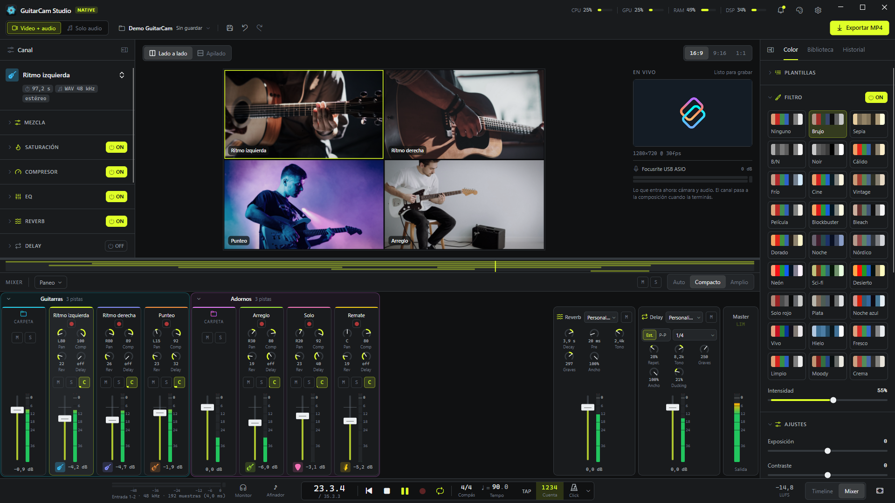
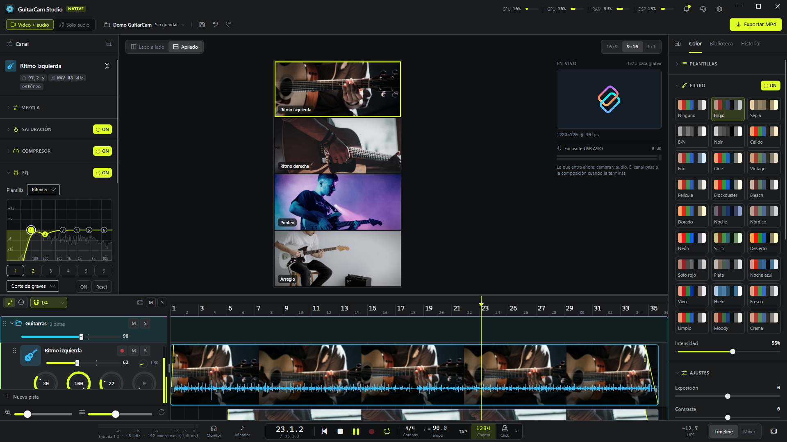
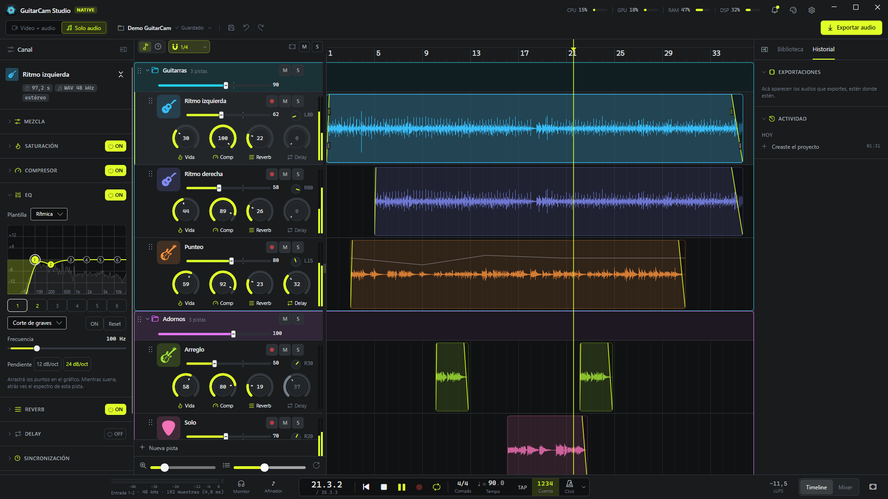

# GuitarCam Studio Native

**Español** · [English](README_EN.md)

**GuitarCam Studio Native** es una aplicación de escritorio para Windows para hacer **videos de guitarra**:
grabás tomas con cámara y audio, las mezclás y exportás un video con un panel por toma.

Funciona tanto como un **cam studio** (grabar tomas con cámara y armar el video) como un **DAW** (grabar,
editar y mezclar audio en un timeline y un mixer completos, con o sin imagen: el modo **Solo audio**
sirve para hacer música sin video).

Está pensada para usarse con la guitarra colgada: atajos de una tecla, botones grandes y un camino corto
de **grabar → mezclar → exportar**.


| | |
|---|---|
|  |  |
| **El mixer**: una tira por pista, las carpetas como VCA, los retornos de reverb y delay y el master. | **Vertical 9:16** para Reels, Shorts y TikTok, con un look de color aplicado. |



*Las capturas son del proyecto de demo; las imágenes de los paneles son fotos de [Unsplash](https://unsplash.com).*

## Qué hace

### Grabar

- Audio por **ASIO** (entrada y salida en un mismo callback, con monitoreo) y video desde una cámara (DirectShow o
  DroidCam por IP). Cada toma se escribe a disco mientras ocurre, así que un corte no la pierde.
- Se graba desde donde esté el cabezal, para regrabar solo un pedazo, con **metrónomo** (compás, tempo, tap tempo,
  cuenta previa y seis sonidos de click) y **calibración de latencia** con cable o tocando.
- **Afinador** con notas en castellano, flechas que te dicen para dónde girar la clavija y sensibilidad ajustable.

### Editar

- **Timeline** con varias pistas: clips que se mueven, recortan, dividen y duplican, fades, ganancia por clip con su
  **curva de volumen**, rango de borrado, deshacer y rehacer ilimitados, e importación de audio de afuera (WAV, MP3,
  FLAC, OGG, M4A, AIFF).
- **Carpetas** que se pliegan y agrupan pistas; varias pistas se marcan con Ctrl+clic / Shift+clic y se mueven juntas.
  Cada pista tiene su **color** (24, en orden de arco iris) y un **ícono de instrumento** (guitarras, bajo, batería,
  synths, cuerdas, vientos, percusión…), su propio alto y sus knobs de Vida, Comp, Reverb y Delay en el encabezado.
- Un sonido que te gusta se guarda como **plantilla de pista** y vuelve desde Nueva pista → Plantilla.
- Arriba de la regla, un **rango A–B** para repetir un tramo (practicar el solo, mezclar un pedazo) y **marcadores**
  con nombre (Intro, Estribillo, Solo…) para saltar de una parte a otra. Zoom de un tiempo a toda la canción con
  las teclas 1 a 5.

### Mezclar

- Cadena de efectos por pista: saturación (**Vida**, válvula o cinta), **compresor** con presets (Rasgueo / Arpegio /
  Punteo), **EQ de 6 bandas** con espectro en vivo, y envíos a **reverb** y **delay**, más limitador master y paneo
  con plantillas.
- **Mixer** completo; cada carpeta tiene su propio canal y su fader, M y S mandan sobre todas sus pistas, como un VCA.
- Audio de nivel profesional: arrancar, parar, saltar y arrastrar el cabezal llevan su fundido, sin clics ni cortes.

### Armar el video

- Un panel por pista con cover-fit, zoom, paneo y espejo; relaciones **16:9 / 9:16 / 1:1**, disposición lado a lado
  o apilada.
- Pestaña de **color** con 26 looks (Brujo, Cine, Moody, Fresco, Noche azul, Hielo…), ajustes (exposición, contraste,
  Blancos, Negros, Sensación de luz…), efectos y plantillas. Lo que ves en la vista previa es lo que se exporta.

### Exportar

- **MP4** (mezcla offline + FFmpeg, con progreso y cancelación), con presets para **Reels · TikTok**, **YouTube** e
  **Instagram** (1:1 y 4:5) que acomodan el cuadro y llevan la mezcla a −14 LUFS.
- En el modo **Solo audio**, WAV de 24 bits o MP3 de 320 kbps; si querés, además cada pista en su WAV (stems).
  Medidor de **LUFS** del master en la barra de transporte.
### Y además

- **No pierde nada**: guardado atómico (solo después de cada edición, cada X minutos o a mano con Ctrl+S o el
  diskette, a elección en Configuración → Guardado; las tomas se guardan siempre), copias en `historial/` para volver
  atrás, recuperación de grabaciones interrumpidas y un gestor de proyectos con Papelera.
- Idiomas, tema y atajos de teclado configurables.

## Hacia dónde va

GuitarCam Studio Native está **en desarrollo constante**. La idea es llevarla a un nivel que sirva tanto
para quien recién empieza y quiere hacer música rápido y sin complicaciones, como para profesionales que
quieren hacer música en serio.

Lo próximo es la compatibilidad con **MIDI**, **plugins VST** y más herramientas de estudio. Lo que está
planeado y lo que falta está en [PENDIENTES.md](PENDIENTES.md).

## Requisitos

- Windows 10/11 de 64 bits.
- Una interfaz de audio con driver **ASIO**.
- **FFmpeg** y **ffprobe** en el `PATH` (cámara, video y exportación).
- [.NET 10 SDK](https://dotnet.microsoft.com/) para compilar.

## Compilar y ejecutar

```
tools\probar.ps1 "qué probar"
```

Compila, corre `gclab comprobar-dsp`, copia la app a `%LOCALAPPDATA%\GuitarCam Pruebas\<fecha>-<commit>` (quedan las
últimas 5) y la abre desde ahí, con la marca "PRUEBA <commit>" en la barra de título. Como nunca corre desde `bin\`,
la app abierta no traba la próxima compilación. `-Abrir` abre la última copia sin compilar, `-NoAbrir` solo compila y
copia, `-SinComprobar` salta `gclab`, `-Proyecto carpeta` abre ese proyecto. Si ya hay un GuitarCam abierto, antes de abrir
pregunta en un cuadro si lo cierra (guarda el proyecto antes), así la copia nueva no abre el mismo proyecto en solo
lectura. Si algo falla, dice "NO SE PUEDE PROBAR" y no abre nada. `dotnet build` solo sigue sirviendo para compilar.

La app arranca en el gestor de **Proyectos** (lista, buscador, plantillas, renombrar, duplicar, Papelera).
Con una carpeta de proyecto como argumento, la abre directo. Con `--probar "texto"` muestra ese texto en un aviso fijo ("Para probar") al abrir. `tools\make-shortcut.ps1` crea un acceso
directo en el escritorio que abre la última copia de prueba (`probar.ps1 -Abrir`). Los ajustes se guardan en `%APPDATA%\GuitarCam Studio`.

## Atajos principales

Todos se pueden cambiar en ⚙ Configuración → Atajos de teclado (menos Esc).

| Tecla | Acción |
|---|---|
| Espacio | reproducir / parar |
| Shift+R o Num * | grabar (grabando: detener y guardar) |
| R | armar / desarmar la pista seleccionada |
| Inicio | volver al principio |
| L | repetir en loop (el rango A–B, o todo el tema) |
| I / O | inicio (A) / final (B) del rango en el cabezal |
| K / , / . | marcador en el cabezal / ir al anterior / al siguiente |
| C / Shift+C / T | click / cuenta previa / tap tempo |
| A | afinador |
| M / S | mute / solo de la pista |
| F | ver todo |
| 1 a 5 | zoom: 1 tiempo / 1 compás / 4 compases / 16 compases / toda la canción |
| X | timeline / mixer |
| Alt+X / D | dividir el clip en el cabezal / duplicarlo |
| Supr | quitar el clip (o la pista vacía) |
| Ctrl+Z / Ctrl+Y | deshacer / rehacer |
| Ctrl+Shift+N | nueva pista |
| Ctrl+clic / Shift+clic en un encabezado | marcar varias pistas (una por una / un rango) para moverlas juntas |
| Ctrl+S | guardar ya |
| B / P | mostrar u ocultar el panel de la toma / del proyecto |
| Rueda, Shift+rueda, Ctrl+rueda, Alt+rueda | subir y bajar, zoom, desplazar a los costados, alto de pista (los modificadores y el sentido de cada uno, con "Invertir", se cambian en Configuración → Atajos de teclado; zoom y alto también con los sliders al pie de los encabezados) |

En el clip seleccionado, un clic sobre su línea de volumen agrega un punto; los puntos se arrastran y un
doble clic los saca.

En la franja de arriba de la regla, arrastrar marca el rango A–B (y prende el loop); sus bordes y el rango entero se
arrastran. Doble clic agrega un marcador; los marcadores se arrastran, un clic salta ahí y doble clic los renombra.
Clic derecho en la franja: agregar marcador, empezar o terminar el rango ahí, sacarlo, y en un marcador ponerle un
nombre de la lista o repetir hasta el siguiente. Un rango marcado con Shift+arrastrar en una pista también se puede
repetir desde su menú.

Cada pista o carpeta puede tener su propio alto: arrastrá el borde de abajo de su encabezado (doble clic en el borde
la vuelve al alto general). El botón ↺ al pie de los encabezados iguala todas.

## Cómo está hecho

```
src/
  GuitarCam.Audio      motor de audio: DSP, ASIO dúplex, click, grabación a disco, exportación
  GuitarCam.Projects   modelo del proyecto, guardado atómico, historial, gestor de proyectos
  GuitarCam.App        la ventana (Avalonia 11.3)
  GuitarCam.Lab        gclab.exe: consola para probar audio, DSP y proyectos sin la ventana
tools/                 ícono, acceso directo y utilidades de verificación
```

Las dependencias van hacia abajo (App → Projects → Audio): el motor y el modelo del proyecto no conocen la
interfaz, y todo lo que hacen se puede ejercitar desde `gclab`. El proyecto se guarda en una carpeta:

```
guitarcam.json        el proyecto
guitarcam.json.bak    el guardado anterior
historial/            copias para volver atrás
media/                grabaciones e importados (nunca se reescriben)
exports/              videos y audios exportados
```

## Contribuir y licencia

GuitarCam Studio Native es **gratis y sin fines de lucro**: se hace para la comunidad, para que cualquiera
pueda grabar y hacer música sin pagar un peso. Las contribuciones son bienvenidas y **todas pasan por la
aprobación del mantenedor**: abrí un issue o un Pull Request siguiendo [CONTRIBUTING.md](CONTRIBUTING.md).
Antes de tocar código, leé [AGENTS.md](AGENTS.md) (la guía del proyecto) y mirá [PENDIENTES.md](PENDIENTES.md)
para ver qué falta.

Se distribuye bajo la licencia [GPL-3.0](LICENSE): podés usarla, estudiarla, modificarla y compartirla
libremente, y las versiones modificadas que se distribuyan tienen que seguir siendo libres bajo la misma licencia.

## gclab

`gclab.exe` (`src\GuitarCam.Lab\bin\Debug\net10.0-windows\gclab.exe`) prueba el motor y los proyectos desde
la consola, sin abrir la ventana.

| Comando | Qué hace |
|---|---|
| `dispositivos` / `panel` | drivers ASIO y dispositivos WASAPI / panel del driver (tamaño de buffer) |
| `latencia [--modo cable\|tocando] [--ver] [--borrar]` | mide la latencia ida y vuelta, o muestra / borra la guardada |
| `grabar --monitor --sat valvula` | graba sobre el click; con `--monitor` te escuchás con el efecto (también `--ganancia`, `--descartar`, `--entradas 1,2,3-4`) |
| `mezclar proyecto\|toma.wav [--salida mezcla.wav]` | renderiza la mezcla offline, con el mismo grafo que la reproducción |
| `procesar toma.wav --sat cinta --comp-estilo punteo --eq ritmica --reverb cuarto --delay punteada` | aplica efectos a un WAV |
| `click` | escribe todos los sonidos de click a un WAV |
| `sistema [--segundos 5]` | CPU, GPU y RAM, y si FFmpeg está en el PATH |
| `espectro [toma.wav]` | el espectro en vivo del EQ |
| `comprobar-dsp` | comprobaciones propias del DSP: remuestreo, tomas, reinicio de la cadena, afinador y LUFS |
| `looks [--look id] [--salida look.cube] [--blancos n] [--negros n] [--luz n]` | los looks de color con colores de prueba, comprobación de rango y, con `--look`, el LUT `.cube` de ese look con Blancos, Negros y Sensación de luz |
| `lufs archivo` / `afinar archivo [--en segundos] [--umbral -50]` | volumen integrado de un archivo / la nota que oye el afinador en ese momento, con la sensibilidad de la ventana (dB) |
| `camara [listar]` | las cámaras que ve FFmpeg y sus formatos |
| `camara grabar [--dispositivo X \| --ip 192.168.1.50:4747] [--segundos 5]` | graba video como una toma y lo revisa con ffprobe |
| `camara verificar-corte` | corta una grabación a la mitad y comprueba que el video quede |
| `exportar [proyecto] [--calidad alta\|estandar\|borrador] [--salida nombre]` | exporta el MP4 |
| `exportar proyecto --audio wav\|mp3` | exporta solo la mezcla |
| `exportar proyecto … --stems` | además, un WAV por pista en `<nombre> - stems` |
| `exportar proyecto … --destino reels\|youtube\|ig-square\|ig-portrait [--lufs -14] [--cola 8]` | con el cuadro y el volumen de esa red; `--lufs` lleva la mezcla a ese volumen integrado, `--cola` deja sonar reverb y delay hasta N s después del último clip (0 = corta). Muestra los LUFS del resultado |
| `proyecto abrir\|clips\|versiones\|volver carpeta` | abre un proyecto, lista pistas y clips, y recorre el historial |
| `proyecto toma\|cortar carpeta [--camara]` | graba un tono como la ventana / lo corta sin cerrar, para probar la recuperación |
| `proyecto editar carpeta mover\|recortar-inicio\|recortar-final\|fade-in\|fade-out clip delta` | edita un clip como en el timeline (más: `a-pista`, `dividir`, `duplicar`, `ganancia`, `curva`, `quitar-clip`, `nueva-pista`…) |
| `proyecto editar carpeta nueva-carpeta\|a-carpeta\|sacar-de-carpeta\|mover-carpeta\|quitar-carpeta\|carpeta …` | carpetas de pistas: agrupar, mover adentro y afuera, fader, mute y solo |
| `proyecto editar carpeta guardar-plantilla pista [nombre] \| usar-plantilla nombre`, `proyecto plantillas-de-pista x` | plantillas de pista (`pistas.json`) |
| `proyecto encuadre\|sincronia\|formato\|modo carpeta …` | encuadre del clip, ajuste de sincronía, formato del video y modo Video / Solo audio |
| `proyecto importar-audio carpeta archivo` | copia un audio de afuera a `media/` y lo pone en una pista |
| `proyecto marcadores carpeta [agregar\|mover\|renombrar\|quitar …]`, `proyecto repetir carpeta [desde hasta \| --quitar]` | marcadores del tema y rango A–B del loop |
| `proyecto historial carpeta` | tomas en uso y no usadas, exportaciones y actividad |
| `proyecto verificar-deshacer\|verificar-clips\|verificar-tomas\|verificar-importar\|verificar-historial\|verificar-carpetas\|verificar-marcadores` | pruebas automáticas sobre una carpeta temporal |
| `proyectos lista\|plantillas\|nuevo\|renombrar\|duplicar\|borrar\|olvidar\|carpeta` | lo que hace el gestor de proyectos |
| `proyectos guardar-plantilla\|borrar-plantilla` | plantillas de proyecto del usuario |
| `proyectos plantillas-video\|guardar-plantilla-video\|aplicar-plantilla-video\|borrar-plantilla-video` | plantillas de video (filtro, ajustes y efectos) |

En `proyecto` y `proyectos`, `--datos X` usa otra carpeta para la configuración, los recientes y las
plantillas (para probar sin tocar los tuyos), y `--raiz X` otra carpeta de proyectos.
