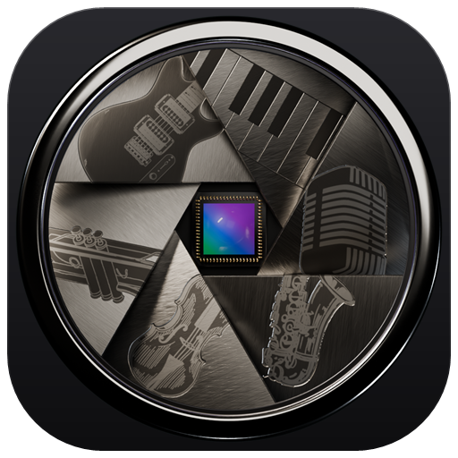
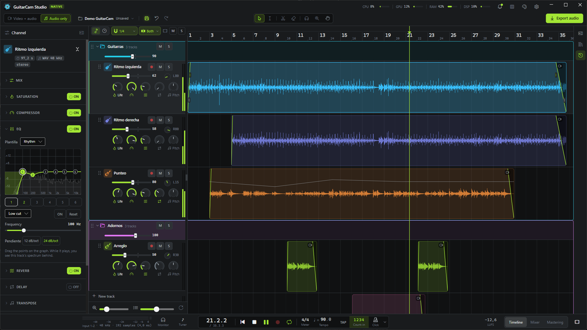
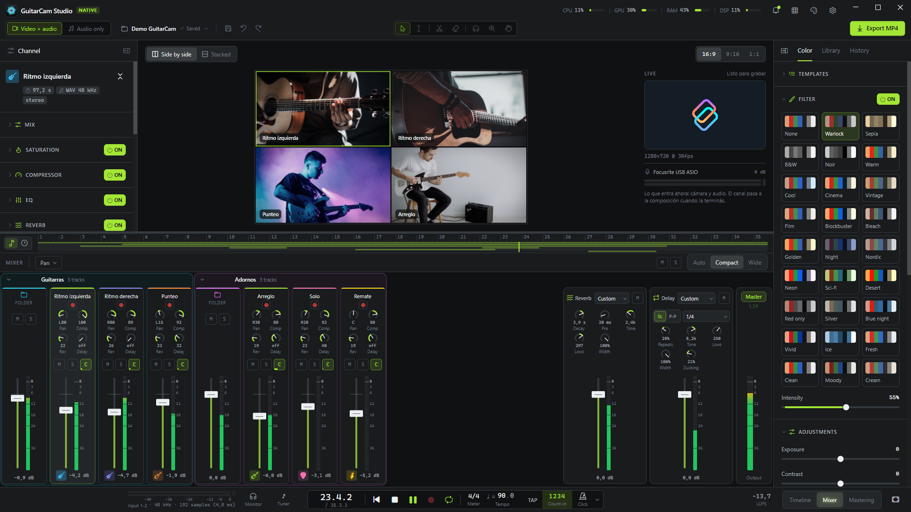
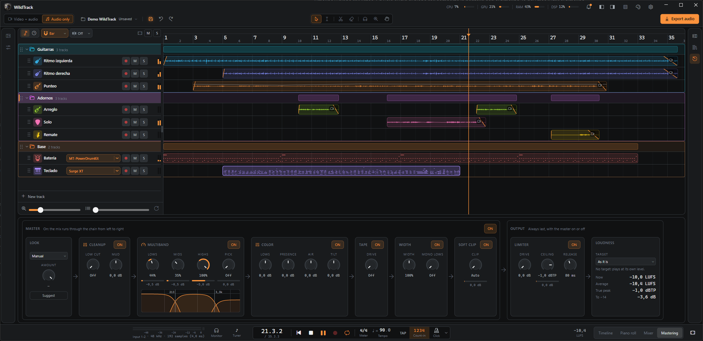
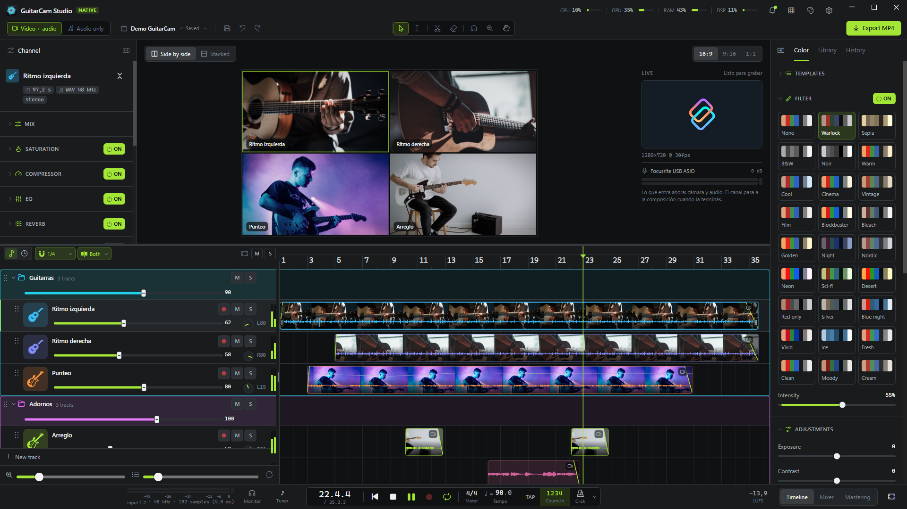
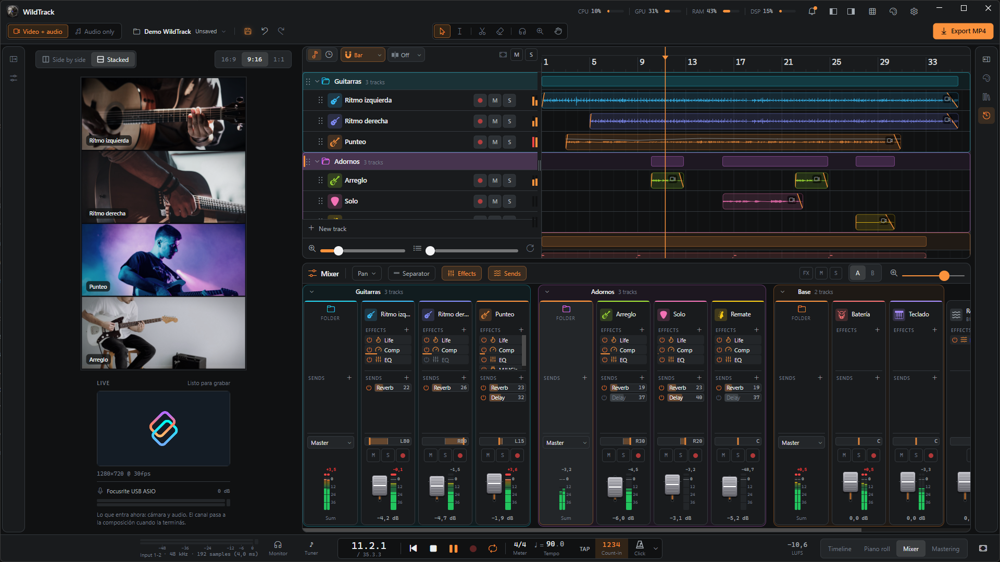

<p align="center">
  
</p>

<h1 align="center">WildTrack</h1>

<p align="center">
  <b>A DAW to record, mix, master and export music on Windows.</b><br>
  Audio and MIDI, VST3 instruments and effects, buses and mastering. And if you record with a camera, the video too.
</p>

<p align="center">
  <a href="README.md">Español</a> · <b>English</b>
</p>

<p align="center">
  <a href="https://github.com/xtrimdr/WildTrack/releases/latest/download/WildTrack-Setup.exe">
    
  </a>
  <br>
  <sub>Windows 10/11, 64-bit · self-contained installer, no .NET install needed</sub>
</p>

**WildTrack** is a DAW for any instrument and any style: guitar, bass, vocals, keys, drums, a whole band or a
production built in the computer. You record, edit, mix, master and export with audio and MIDI tracks, a piano roll,
VST3 instruments and effects, buses and a full master chain.

It also makes **videos**: if you record with a camera, every take keeps its picture and WildTrack builds a video with
one panel per take, with color grading and formats for social media. It is an extra for when you need it; without a
camera, it works like any other DAW.

It used to be called **GuitarCam Studio Native**: when you update, your settings and projects are still there.

<details>
<summary><b>Before installing</b></summary>

- **FFmpeg** and **ffprobe** on the `PATH`, for the camera, video and export.
- An audio interface with an **ASIO** driver, to record.
- The installer isn't signed: if Windows SmartScreen warns you, choose **More info → Run anyway**.

More details in [Requirements](#requirements).
</details>



| | |
|---|---|
|  |  |
| **Mixer**: one strip per track, folders, buses and the master. | **Mastering**: look, cleanup, multiband, color, tape, width, soft clip and limiter, with a loudness target and "Suggest". |
|  |  |
| **Video mode**: one panel per take and the color tab. | **Vertical 9:16** for Reels, Shorts and TikTok, with the Vertical layout. |

*The screenshots show the demo project; the panel images are photos from [Unsplash](https://unsplash.com).*

## What it does

### Record

- Audio over **ASIO** (input and output in the same callback, with monitoring). Each take is written to disk as it
  happens, so a crash does not lose it.
- Recording starts at the playhead, so you can redo just one part, with a **metronome** (time signature, tempo, tap
  tempo, count-in and six click sounds) and **latency calibration** with a cable or by playing.
- **MIDI** from keyboards and controllers: each MIDI track picks its input and channel, plays live through its
  instrument and records the notes into a clip.
- A **tuner** with arrows that show which way to turn the peg and adjustable sensitivity.

### Edit

- A multitrack **timeline**: clips you can move, trim, split and duplicate, fades, clip gain with its own **volume
  curve**, range delete, unlimited undo and redo, and audio import (WAV, MP3, FLAC, OGG, M4A, AIFF). **Detect tempo**
  on any clip (right-click) and set the project to those BPM.
- **MIDI tracks** with a **piano roll**: double-click on the lane creates a clip and opens it. Click writes a note,
  dragging moves or lengthens it, right-click deletes it, and each note's velocity sits below.
- **Extract MIDI**: the notes of an audio clip (chords or melody) go to a MIDI track, from the right-click or by
  dragging the clip onto a MIDI track (Spotify's Basic Pitch, on the CPU).
- **Folders** that fold and group tracks; Ctrl+click / Shift+click marks several tracks to move them together. Each
  track gets its own **color** (24, in rainbow order), an **instrument icon** (guitars, bass, drums, synths, strings,
  winds, percussion…), its own height and Vida, Comp, Reverb, Delay and Pitch knobs in its header (which ones show,
  in Settings → View).
- A sound you like saves as a **track preset** and comes back from New track → Preset.
- Above the ruler, an **A–B range** loops a stretch and named **markers** (Intro, Chorus, Solo…) jump from one part
  to another. Zoom from one beat to the whole song with shortcuts you assign in Settings → Keyboard shortcuts.

### VST3 instruments and effects

- Each MIDI track plays through a **VST3 instrument** (Surge XT, MT-PowerDrumKit…: right-click the track →
  Instrument, or the piano roll button, which also opens the plugin window) or, with no plugin, a test tone.
- **VST3 effects** on channels and buses (amps, pedals, third-party reverbs): "+ Effect" → VST3, in any order
  alongside the built-in ones; "Open" shows its window and what you set there is saved in the project.
- Each plugin runs in its own process: if one hangs, only that one goes quiet and the rest keeps playing. Plugin
  latency is compensated across the whole mix, the click and the takes you record on top (PDC), and the export runs
  through the same plugins.

### Mix

- A per-channel effects chain, in any order: saturation (**Vida**, tube or tape), a **compressor** with presets
  (Strumming / Arpeggio / Lead), a **6-band EQ** with live spectrum and a **noise gate**, plus pan templates, a
  **MONO** button to check the mix and **FX** to hear it without effects.
- **Transpose** per track (−12 to +12 semitones) without changing the length: it is computed in the background
  (about 4 s per 3 min) with a high-quality phase vocoder, progress shows on the clips and the result is kept in
  `cache/`.
- A full **mixer** with **buses**: every track or folder picks its output (the master or a bus) and sends to the
  buses (before or after the fader); the buses go to the master. A bus has volume, pan and effects: use it for a
  reverb, a delay or to process a group. Folders only group. Strips are reordered by dragging (the timeline
  follows), sit on the left or the right, and named separators keep big projects tidy.
- **A | B** on the mixer bar: two mixes of the same takes (channels, sends and buses) to compare while it plays;
  B starts as a copy of A, and right-click copies one over the other or forgets the other.
- Professional-grade audio: starting, stopping, jumping and dragging the playhead all fade, with no clicks or dropouts.

### Master

- A **Mastering** view with the master chain: look, cleanup, multiband, color, tape, width, soft clip and a true-peak
  limiter. **Suggest** listens to the mix and proposes settings.
- A loudness **Target** (YouTube, Instagram, TikTok, Spotify, Apple Music): you hear it while mixing and the export
  follows it. A **LUFS** meter sits in the transport bar.

### Export

- Audio as 24-bit **WAV** or 320 kbps **MP3**; optionally each track in its own WAV too (**stems**).
- **Just the A–B loop** ("Range" in the dialog) to cut a part of the song, with reverb and delay ringing out after B.
- The mix uses every processor core.

### Videos

- With a camera (DirectShow or DroidCam over IP), every take also records its picture, in sync with the audio.
- A panel per track with cover-fit, zoom, pan and mirror; **16:9 / 9:16 / 1:1** aspect ratios, side-by-side or
  stacked layout, and the **Vertical** window layout to work in 9:16.
- A **color** tab with 28 looks (Brujo, Cine, Moody, Fresco, Noche azul, Hielo, Soñado, HDR…), adjustments
  (exposure, contrast, whites, blacks, light…), effects (sharpness, clarity, glow, vignette, grain, cinema bars) and
  templates. What you see in the preview is what gets exported.
- **MP4** export with presets for **Reels · TikTok**, **YouTube** and **Instagram** (1:1 and 4:5); under
  **Advanced**, the resolution (720p to 4K) and bitrate. The video is encoded on the **video card** (NVIDIA, AMD or
  Intel) when there is one; if it fails, it carries on with the processor.
- **Social length marks** on the ruler (right-click): where a story, an X post, a Reel or Short and a TikTok end. If
  the song runs over, the line turns amber.

### And also

- **Never loses anything**: atomic saving (after every edit, every X minutes or by hand with Ctrl+S or the disk
  button, chosen in Settings → Saving and export; takes are always saved), the **History** tab to go back (every step
  of the session by name, one click away, and saved versions: automatic, named or the one of each export), recovery
  of interrupted recordings and a project manager with a Recycle Bin and **ZIP packages** to take a project to
  another computer or keep a full backup.
- Configurable language, theme, keyboard shortcuts and window layout (Classic or Vertical).

## Where it is going

WildTrack is **under constant development**. The goal is to take it to a level that works both
for people just starting out who want to make music quickly and without complications, and for professionals
who want to make music seriously.

MIDI tracks with a piano roll and VST3 instruments and effects are in; next up are knobs of your own for the plugins'
parameters, a built-in sampler and more studio tools. What is planned and what is missing is
in [PENDIENTES.md](PENDIENTES.md) (in Spanish).

## Requirements

- Windows 10/11, 64-bit.
- An audio interface with an **ASIO** driver.
- **FFmpeg** and **ffprobe** on the `PATH` (camera, video and export).
- [.NET 10 SDK](https://dotnet.microsoft.com/) to build.

## Build and run

```
tools\probar.ps1 "what to try"
```

It builds, runs `wtlab comprobar-dsp`, copies the app to `pruebas\<date>-<commit>` (ignored by git; the last
5 are kept) and opens it from there, marked "TEST <commit>" in the title bar. Since it never runs from `bin\`, an open
app does not block the next build. `-Abrir` opens the newest copy without building, `-NoAbrir` only builds and copies,
`-SinComprobar` skips `wtlab`, `-Proyecto folder` opens that project. If a WildTrack is already open, a dialog asks first whether to close it
(it saves the project before closing), so the new copy does not open the same project read-only. Plain `dotnet build` still works for building.

The app starts in the **Projects** manager (list, search, templates, rename, duplicate, Recycle Bin). With a
project folder as an argument, it opens it directly. `tools\make-shortcut.ps1` creates a desktop shortcut that opens the newest test copy (`probar.ps1 -Abrir`).
Settings are stored in `%APPDATA%\WildTrack`.

## Main shortcuts

All of them can be changed in ⚙ Settings → Keyboard shortcuts (except Esc). The interface itself is in
Spanish by default; the language is chosen in Settings.

| Key | Action |
|---|---|
| Space | play / stop |
| Shift+R or Num * | record (while recording: stop and save) |
| R | arm / disarm the selected track |
| Home | back to the start |
| L | loop (the A–B range, or the whole song) |
| I / O | range start (A) / end (B) at the playhead |
| K / , / . | marker at the playhead / go to the previous / the next one |
| C / Shift+C / T | click / count-in / tap tempo |
| A | tuner |
| M / S | mute / solo the track |
| F | fit all |
| X | timeline / mixer |
| Alt+X / D | split the clip at the playhead / duplicate it |
| Del | remove the clip (or the empty track); with a range, delete it |
| Shift+Del | delete the range and close the gap (what follows slides left) |
| 1 to 7 | tools: Select / Range / Split / Erase / Listen / Zoom / Hand |
| Ctrl+Z / Ctrl+Y | undo / redo |
| Ctrl+Shift+N | new track |
| Ctrl+click / Shift+click on a header | pick several tracks (one by one / a range) to move them together |
| Ctrl+S | save now |
| B / P | fold or open the channel panel / the project panel (hidden with its title bar button, it shows it again) |
| F11 | full screen (F11 again goes back to how it was) |
| Wheel, Shift+wheel, Ctrl+wheel, Alt+wheel | scroll up and down, zoom, scroll sideways, track height (the modifiers can be changed in Settings → Keyboard shortcuts). In the mixer, the plain wheel and Ctrl+wheel scroll sideways and Shift+wheel (or the bar in its header) widens or narrows the channels |

On the selected clip, a click on its volume line adds a point; points drag, and a double-click removes one.

On the strip above the ruler, a drag sets the A–B range (and turns the loop on); its edges and the whole range drag.
A double-click adds a marker; markers drag, a click jumps there and a double-click renames them. Right-click the strip
to add a marker, start or end the range there or remove it, and on a marker to pick a name from the list or loop to
the next one.

The timeline tools sit in the middle of the project bar: **Select** (as always), **Range** (marks a stretch of one or
several tracks; right-click: delete it, delete it and close the gap, loop it), **Split** (a click cuts the clip
there, on the grid), **Erase** (removes the clips it touches), **Listen** (hold the button on a clip to hear that
track alone from there), **Zoom** (click zooms in, Alt+click out, a drag shows that stretch) and **Hand** (drag to
move the view). Where two clips of a track overlap, right-click → **Bring to front** picks which one shows.
**Lock clip** or **Lock track** (right-click) pins a take that came out right: it can't be moved, trimmed or deleted
and recording won't replace it; volume, fades and framing still change.

## How it is built

```
src/
  WildTrack.Audio      audio engine: DSP, duplex ASIO, click, recording to disk, export
  WildTrack.Projects   project model, atomic saving, history, project manager
  WildTrack.App        the window (Avalonia 11.3)
  WildTrack.Lab        wtlab.exe: console to test audio, DSP and projects without the window
tools/                 icon, shortcut and verification utilities
```

Dependencies point downward (App → Projects → Audio): the engine and the project model know nothing about
the interface, and everything they do can be exercised from `wtlab`. A project is saved in a folder:

```
guitarcam.json        the project
guitarcam.json.bak    the previous save
historial/            copies to go back to
media/                recordings and imports (never rewritten)
exports/              exported videos and audio
```

## Contributing and license

WildTrack is **free and non-profit**: it is made for the community, so anyone can record and
make music without paying a cent. Contributions are welcome and **all of them go through the maintainer's
approval**: open an issue or a Pull Request following [CONTRIBUTING.md](CONTRIBUTING.md). Before touching code,
read [AGENTS.md](AGENTS.md) (the project guide, in Spanish) and see [PENDIENTES.md](PENDIENTES.md) for what is
missing.

It is released under the [GPL-3.0](LICENSE) license: you can use, study, modify and share it freely, and
distributed modified versions must stay free under the same license.

## Code signing policy

The installer is built by GitHub Actions from this repository ([instalador.yml](.github/workflows/instalador.yml)),
never on anyone's machine, so what you download comes from this code. Free code signing provided by
[SignPath.io](https://about.signpath.io), certificate by [SignPath Foundation](https://signpath.org).

- Committers and reviewers: [xtrimdr](https://github.com/xtrimdr) (every outside change goes through their approval).
- Approvers: [xtrimdr](https://github.com/xtrimdr).

**Privacy policy**: this program will not transfer any information to other networked systems unless specifically
requested by the user or the person installing or operating it: it checks GitHub's latest release for a new version
(it can be turned off in About) and connects to the network camera you set up.

## wtlab

`wtlab.exe` (`src\WildTrack.Lab\bin\Debug\net10.0-windows\wtlab.exe`) tests the engine and projects from the
console without opening the window. Its commands and options are in Spanish (for example `grabar`, `mezclar`,
`exportar`, `proyecto`, `proyectos`); run it without arguments to see the help, or see the command table in
the [Spanish README](README.md#wtlab).
